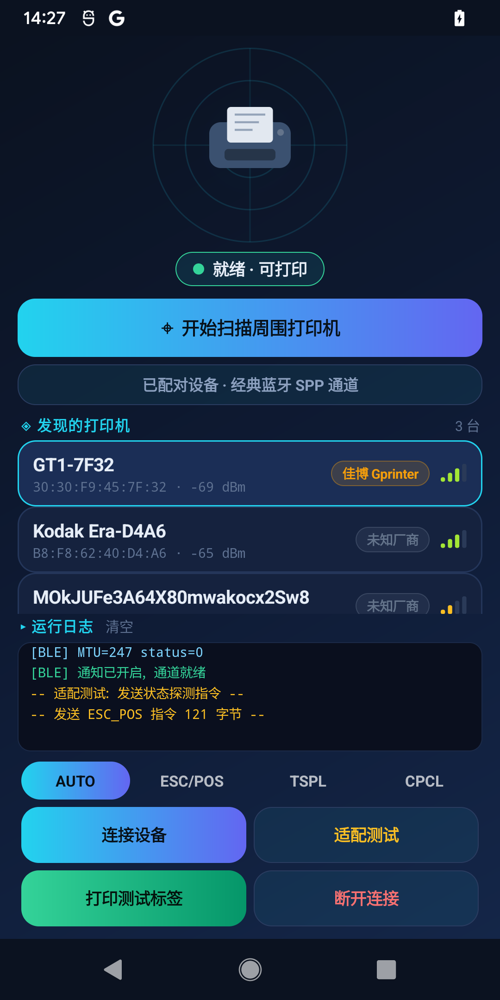
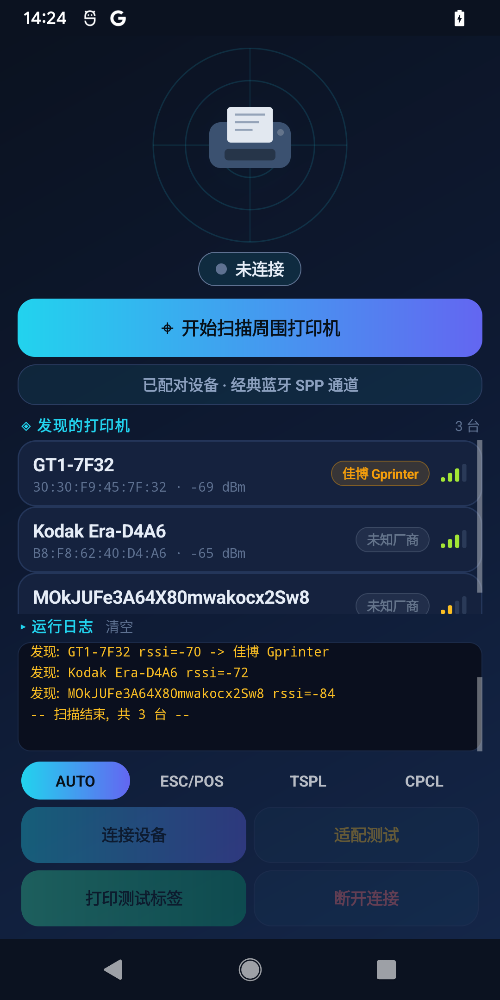

# 多厂家蓝牙打印机连接 Demo（Dlabel 技术复刻）

学习自 Dlabel 云标签 APK 逆向分析的多厂家打印机「搜索-识别-连接-适配」完整技术方案。
纯 Android SDK 实现，无任何第三方依赖，minSdk 21。

**已于真机全链路验证**（Pixel 3 / Android 12）：扫描发现佳博 GT1-7F32 → 前缀识别 →
GATT 命中 ff00/ff02 → MTU 247 → 通知就绪 → 探测指令 → ESC/POS 测试标签发送成功。

|  |  |
|---|---|
| 连接就绪（佳博命中 ff00/ff02） | 扫描识别（厂商徽章 + RSSI 信号条） |

## 构建

方式一（推荐，无需 Android Studio / Gradle）：

```bash
cd demo
./build_apk.sh          # 需要 ANDROID_SDK_ROOT，含 build-tools 36 + platform android-35
# 产物: demo/BlePrinterDemo.apk
```

方式二：用 Android Studio 直接打开本目录补一个 Gradle 配置即可（代码无 Gradle 依赖）。

## 使用

1. 安装到手机（Android 5.0+，建议真机——模拟器无蓝牙）
2. 打印机开机待机 → 点「⌖ 开始扫描周围打印机」（或点雷达）→ 授权
3. 卡片列表中选择设备（自动标注识别出的厂商徽章，信号条实时跳动）
4. 点「连接设备」→ 状态胶囊变绿「就绪·可打印」，日志显示命中的 UUID 配置（或自动降级枚举结果）
5. 点「适配测试」发探测指令，看打印机回包（对应 Dlabel 的"打印机适配测试"）
6. 底部协议芯片选择 AUTO/ESC-POS/TSPL/CPCL → 点「打印测试标签」

找不到打印机时：把打印机用系统设置配对后点「已配对设备 · 经典蓝牙 SPP 通道」
——对应 Dlabel 的「切换蓝牙模式」。

## 架构（对应 Dlabel 四层机制）

| 文件 | 对应机制 |
|---|---|
| `VendorDB.java` | 名称前缀识别厂商（assets/printlist.list）+ 各厂商 GATT UUID 候选表 |
| `BleScanner.java` | BLE 无过滤扫描 + 回调里前缀分类（ScanFilter 不支持前缀） |
| `BlePrinterConnection.java` | GATT 连接 → 服务发现 → UUID 候选表命中/自动降级 → MTU 247 → CCCD 开通知 → 按写入回调分片流控 |
| `ClassicSppConnection.java` | 经典蓝牙 SPP 双通道（台式机/切换模式） |
| `LabelProtocols.java` | ESC/POS、TSPL、CPCL 三族测试标签 + 探测指令 |
| `RadarView.java` / `SignalBarsView.java` | 雷达扫描动画 / RSSI 信号条（自绘控件） |

## 关键工程要点（踩坑总结）

1. **ScanFilter 只支持设备名全匹配**，多厂家前缀识别必须无过滤扫描+代码分类；
2. **写入必须排队流控**：等 `onCharacteristicWrite` 成功再发下一包，否则丢包；
3. MTU 协商到 247 后有效载荷是 MTU-3；协商失败按 20 字节兜底分片；
4. 通知特征必须写 CCCD(0x2902)=0x0001 才能收到打印机状态回包；
5. 每个厂商的 UUID 并不可靠（同厂不同批次固件 UUID 会变），所以必须有
   **「候选表 → 自动枚举 PROPERTY_WRITE/PROPERTY_NOTIFY」的降级链**；
6. 连接前 `cancelDiscovery()`，经典蓝牙 SPP 才能连上；
7. **Android 12+ 扫描不出结果的隐形坑**：`BLUETOOTH_SCAN` 不加 `neverForLocation`
   时，系统要求同时有定位权限才派发扫描结果，否则**静默过滤**（不报错）——
   务必实现 `onScanFailed` 并检查权限组合。
